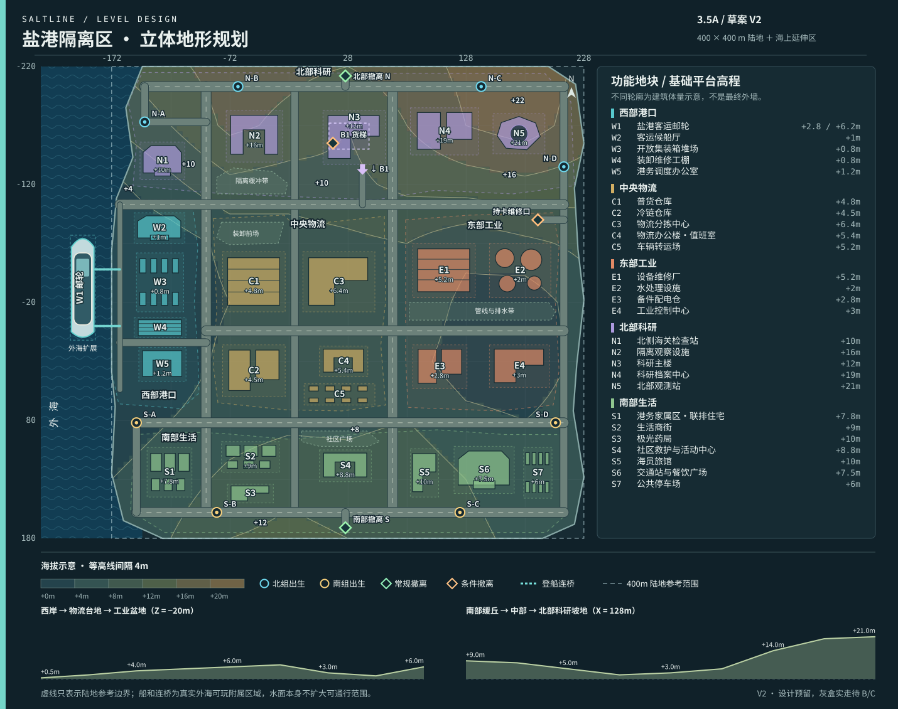

# 盐港隔离区 · 3.5A 总体规划 V1

**状态：规划完成，待用户审阅。** 这不是已经生成或上线的地图。基线为第三阶段 `a67b2b3`，需求见[地图质量重构](MAP_REBUILD.md)。本增量不改运行时代码和存档。

俯视图北朝上，西临海。图中方框代表预留建设范围，不是最终建筑外墙或实际可行走面积；主路是整体连接骨架，不是所有步行道。字母数字为稳定区域/地标 ID，后续任务、资源、地图标注均引用这些 ID。B1 虚线投影仅用于设计检查，正式地图需独立楼层展示。

## 1. 世界布局与尺度

- 保留当前 400×400 m、X=[−172,228]、Z=[−220,180] 的世界范围，北部 Z 为负。原西侧填充地面中的一段改为水域（X −172 至 −142、Z −103 至 44）；邮轮和登船连桥位于原边界内，不额外扩大全地图。
- 五个地面区、一个地下实验区，以及邮轮两层完整可探索区。蓝图预留 26 个重要功能地块，不是 26 栋重复的独立建筑：港区堆场、物流园区、家属区等地块允许多栋不同功能建筑。取消以 51 栋同款街屋铺满道路的做法。
- 主路保留港口城市应有的组织功能；区域内部采用独立道路断面、小巷、曲折庭院、厂内排水带、研究区缓冲绿带及公共场地，避免整个地图只是直线街道和方形建筑。预留四处不规则公共空间与工艺场地，其内部布局在 B/C 定稿。
- 区域外围、道路和地标优先于建筑填充；不在道路净空、登船连接及出口前场摆放阻断通行的装饰物。不可玩边界使用海面、封闭设施、围栏、地形或道路尽头自然说明，不依靠看不见的矩形墙。

| 区域 | 预留范围（m） | 独立外观语言 | 主要探索体验 |
| --- | --- | --- | --- |
| W 西部港口 | 74×179 | 白青船体、吊机、海岸、码头黄线、锈蚀海工材料 | 宽开敞水岸、箱内、候船厅与船内空间切换 |
| C 中央物流 | 146×170 | 宽跨厂房、不同屋顶、货车、门洞及冷链设备 | 多用途仓库、前后场、夹层、办公空间 |
| E 东部工业 | 130×170 | 管线、混凝土墙、罐体、橙色维修构件 | 处理池、设备平台、维修厂与控制楼 |
| N 北部科研 | 400×113 | 封闭园区、灰紫导光、科研楼、独立观察设施 | 检查、科研、档案与下层连接 |
| S 南部生活 | 400×92 | 住宅层高、不同商铺门脸、绿化、雨棚与公共空间 | 室内生活陈设、便利补给、交通设施 |

## 2. 各地块的建设清单

下表是后续建模任务的设计输入。资源仅确定类别与空间出处，不锁定掉落率或最终收益。标为重构的地块优先复用可用资产/机制，但允许迁移位置和重新设置空间。标为新建的地块需要独立外观与实际内部功能，不能仅换招牌。

### W · 西部港口（3.5B 优先切片）

| ID | 地标 | 内外景与玩法内容 | 资源锚点 |
| --- | --- | --- | --- |
| W1 | 盐港客运邮轮（新建） | 约 89×21m 预留船体、船舱层和上甲板；见下一节 | 客运记录、行李、普通医疗与港务物资 |
| W2 | 客运候船厅（新建） | 检票大厅、行李整理区、候车座椅、服务台、海侧出入口 | 旅客遗留物、文件、服务物资 |
| W3 | 开放集装箱堆场（重构） | 货箱堆放、装卸区、开放箱、卸货拖车；开口不少于 4 种货物布置，另有空箱及关闭箱 | 港务货物、机械、冷链配件 |
| W4 | 装卸维修工棚（重构） | 维修工作台、港口车辆检修、配件架、露天设备 | 工具、零件、充能耗材 |
| W5 | 港务调度办公室（新建） | 1F 接待与器材间、2F 调度/船舶登记；面向水岸的窗景 | 船舶记录、电子和港务文件 |

**邮轮切片**：做成科幻港区的中小型区域客运邮轮，完整船体有艏艉、层次化甲板、舱窗和客运识别。首版不开启真实航行，也不把船本身作为常规撤离点。船舱主层布置接待、客房走廊、三个不同配置的客房样本、餐厅/公共休息区、船员小工作间、行李库、医务间；上甲板有露天步道、观景区和一个可进入的服务室。计划保留两座连桥，接到同一可行走海侧步道，船舱与上甲板有可实际步行的楼梯。更高的船桥可作为可辨认外形，未开放区域用明确关闭门表达。

船体包络 X −169～−148、Z −77～12；岸线 X −142。两座连桥在 Z −48 与 0 预留横向连接。当前码头实心箱的外部生成器可继续复用外壳，但开口箱必须单独建立底、顶、侧壁与真实门洞，不能保留旧的整块碰撞盒。岸线低台、甲板高度及连桥坡度在 3.5B 灰盒阶段定稿。船体不能被地面平板覆盖，水域必须有明确可玩边界。

### C · 中央物流

| ID | 地标 | 区别化布局 | 资源锚点 |
| --- | --- | --- | --- |
| C1 | 普货仓库（重构） | 密集货架、大叉车通道、签收区和夹层 | 工业、物流普通物资 |
| C2 | 冷链仓库（新建） | 保温门、冷藏舱、外部冷机、低温照明、物料前室 | 冷链组件、医疗耗材 |
| C3 | 分拣中心（重构） | 输送带、分拣区、包裹笼、装卸月台与桥式夹层 | 港务货物、电子设备 |
| C4 | 物流办公楼/值班室（重构） | 接待、办公室、会议室、档案室、2F 值班室 | 维修卡保底位置、物流档案 |
| C5 | 车辆转运场（重构） | 发车位、停车/临时堆放、遮雨棚及货车活动空间 | 散置可拾取物、车辆备件 |

仓储建筑可以共享杆件、屋顶结构和货架模型，不共享整栋布局；至少三种屋顶/入口轮廓。现值班室维修卡交互 ID `duty-card` 保留并迁移到 C4；详细房间和动线在 C 确认后更新对应测试，不保留重复的旧领取点。

### E · 东部工业

| ID | 地标 | 区别化布局 | 资源锚点 |
| --- | --- | --- | --- |
| E1 | 设备维修厂（重构） | 机器检修、工位、备件、夹层工具间 | 机械零件、维修设备 |
| E2 | 水处理设施（重构） | 保留大型罐体、过滤池、检修平台与坡道，增加有用途的地面空间 | 泵组、过滤与计量部件 |
| E3 | 备件配电仓（新建） | 模块化设备架、配电柜、维修物资区 | 电气、充能及工具 |
| E4 | 工业控制中心（新建） | 控制台、检测室、办公与设备间、二层观察室 | 电气模块、控制记录 |

原处理厂平台高程约 +3.2m 的设计可保留，放在 E2；主路为 0m，排水带与管线围绕设施规划，跨越处可正常步行。持卡维修通道沿用既有位置 (189, −90) 与物品条件，其外观改为真实港务检修出口而不是孤立标牌。

### N · 北部科研与 B1

| ID | 地标 | 区别化布局 | 资源锚点 |
| --- | --- | --- | --- |
| N1 | 北侧海关检查站（重构） | 安检/登记大厅、交接台、室内办公室 | 检查文件、港务货物 |
| N2 | 隔离观察设施（新建） | 独立观察室、前室、普通封闭设施与采光走廊 | 观察记录、低中阶医疗 |
| N3 | 科研主楼（重构） | 1F 登记/设施、2F 办公与研究空间、通往原 B1 的入口 | 研究记录、电气及特殊设施 |
| N4 | 科研档案中心（新建） | 档案区、阅览/办公、数据设备间 | 资料、电子、研究物资 |
| N5 | 北部观测站（重构） | 观察平台、资料工位、通信设备 | 观测数据、电气物资 |
| B1 | 地下实验室（保留重构） | 保留现有独立下坡、供电与货梯，拓展入口缓冲、控制室、冷低温保存和隔离观察空间 | 原 `lab-research`、研究样本和独有高价值资源 |

B1 暂用原地理包络 X 12～46、Z −172～−150、地坪 Y −5.4；坡道入口 (40.5, −133) 必须保持地表通路，货梯 (15.4, −155) 仅 B1 可判定。上方科研主楼与地下顶板、坡口必须一起建模，禁止楼层同坐标误触交互。正式任务只在 3.5C/D 验收后绑定地标和容器 ID。

### S · 南部生活服务区

| ID | 地标 | 区别化布局 | 资源锚点 |
| --- | --- | --- | --- |
| S1 | 港务家属区（新建） | 3～4 栋联排住宅，采用同组结构但户型、家具、封闭/开放状态不同；内部庭院 | 生活杂物、普通补给 |
| S2 | 生活商街（重构） | 便利店、五金杂货、餐饮和独立小店；不同开间、门脸、货架与柜台 | 普通补给、生活与贸易物资 |
| S3 | 极光药局（重构） | 唯一该品牌门店；药品货架、柜台、冷藏柜、小型诊疗区 | 医疗、充能耗材 |
| S4 | 社区救护与活动中心（新建） | 简易救护站、活动室、公共服务柜台和社区小广场 | 医疗与基础补给 |
| S5 | 海员旅馆（新建） | 接待、公共楼梯、不同配置房间、布草储物间 | 行李和生活用品 |
| S6 | 交通站与餐饮广场（新建） | 交通候车、室外餐桌/遮阳、独立餐饮室内及车站设备 | 生活与港务杂物 |
| S7 | 公共停车场（新建） | 不同车辆、收费亭、围栏、步行接驳、充电设施 | 普通电子、车辆杂物 |

住宅阵列外允许复用窗、墙、屋顶等模块；禁止一处换色后重复出现在其他社区。独立药局仅 S3 一家；原“潮汐泵房、港务工坊”大量重复外观分别吸收到工业/港务功能，不再沿街均匀生成。未开放高层保留清晰的不开放标志或作为远景，不做假入口。

## 3. 出生与撤离机制（确定规则，待实际落位）

四个北组、四个南组，共八个固定候选。每局先从候选中随机出生，再按出生组计算本局唯一无条件常规出口。预留位置是地图连接锚点，实际角色位置、朝向、周边空间和初始补给在 C 灰盒验证时微调。各候选应有等价的初始补给机会，不额外复制八份可重复售卖的保底奖励。

| 出生组 | 北部检查口 | 南部公路 | 维修通道 | B1 货梯 |
| --- | --- | --- | --- | --- |
| 北 | 本局不可用 | 可用 | 检查维修卡 | 配电、抵达正确楼层及呼梯窗口 |
| 南 | 可用 | 本局不可用 | 检查维修卡 | 配电、抵达正确楼层及呼梯窗口 |

普通出口物理固定，每局开关仅由出生组决定，不随随机事件更改，不消耗钥匙或物资；继续采用入圈倒计时。维修通道和货梯为独立条件出口，不作为唯一的必经退场渠道。旧 `highway` ID 保留但迁移到南部 (26,169)，新增北部 `north-gate` (26,−209)；`service-passage` 和 `lab-lift` 保留。关闭的常规口是明确的“本局未开放”，不是提示缺卡或没有通电。计时器、可用性、现场标志、UI、地图和结算均读取同一状态；死亡优先、计时取消及重新入圈规则沿用。

下表为蓝图脚本对主路连接图的**规划估计**，不是实际角色实走距离。地块内次级通道可能缩短，围栏、室内通行及坡道可能延长。将实际路线的差异留给 B/C 灰盒验证。

| 出生预留位置 | 本局常规撤离 | 主路距离估计 |
| --- | --- | ---: |
| N-A 西北港区入口 | 南部 | 512m |
| N-B 北部服务道路 | 南部 | 463m |
| N-C 科研园侧路 | 南部 | 487m |
| N-D 东北外环 | 南部 | 490m |
| S-A 西南接驳路 | 北部 | 467m |
| S-B 住宅区外侧 | 北部 | 476m |
| S-C 交通站外侧 | 北部 | 464m |
| S-D 东南公路 | 北部 | 469m |

主路估算 463–512m，最大/最小差约 10.6%。按现有常走 4.5m/s、冲刺 7.5m/s，仅作为速度与规模的粗略关系：全程主路约 103–114 秒常走或 62–69 秒冲刺，未计交互、搜刮及角色加减速。实际出击不要求走完整主路，应有地块间次级连接；不允许由于错误的分组或场景阻断使普通出口不可达。规划阶段不设强制全图逗留时间。

## 4. 连接与高程、环境表现

- 主路之间有 20 段预留连接（含两座连桥、实验室入口、撤离口支路）。北侧科研连接、中央转运路、南部生活连接是跨区骨干。地块之间保留服务间隙，内部步行通道由用途决定。
- 码头铺装、工业平台、居民公共空间、排水沟、科研园缓冲带必须拥有不同的地面/设施语言。码头转变为真实岸线；W1 必须建立多层 walk surface，不能沿用现有 `floorAt` 的整块地面默认值。地面通行、船层与夹层测试要使用实际控制器。
- 地上建筑采用地域色阶而非全图相同材质组合。居民采用低层、窗檐、生活装置；物流强调屋顶大跨和装卸；工业强调连续设备；科研强调封闭结构和层级灯光。加入独立屋顶、窗型、内部光照、陈设、磨损、垃圾或散落用品，保持现有风格。
- 普通行人/建筑装饰、屋顶远景和严肃可玩结构分开标记；批处理只合并静态对象，交互物、门、可视楼层、灯源及地标数据独立。沿用空间索引、距离细节裁剪和分段加载。先做到灰盒可走，再做材质细节，避免下一轮大规模打掉精装资产。

## 5. 大小地图的设计契约（3.5D 实施）

统一源数据：地块 ID、真实轮廓、区域边界、道路、可进入入口、楼层与跨层连接、撤离 ID、资源/任务锚点。3.5A 的 [blueprint.json](map-rebuild/blueprint.json) 是规划数据，不是生产几何。B/C 灰盒完成时生成实际地图几何；D 的三套 UI 使用同一个世界坐标变换，不各自手写位置。

| 界面 | 显示与交互 |
| --- | --- |
| 大厅预览 | 等比缩略图、各区及地标，简要撤离机制说明；不泄露下一局准确出生/个人路线 |
| 局内大地图 | M 打开；左键拖动，滚轮以光标为中心缩放，缩放/复位、定位按钮和比尺。地面、B1、船舱、上甲板及选定建筑二层分层，不把上下层容器叠在一个平面。可选择地标、显示当局合法撤离及锁定原因，放置一个自定义路标并显示距离。 |
| HUD 小地图 | 局部等比，玩家居中和方向明确；随当前位置自动分层，显示相关入口及本层可用出口/已发现交互；不显示未发现容器及敌人。 |

打开大地图释放鼠标锁，地图 UI 自己处理拖动和滚轮，禁止误触游戏操作；仿真、敌人及撤离计时继续推进。关闭时在合法用户手势下恢复鼠标锁；不与背包、暂停、药品轮盘等窗口重叠。保持重绑定键和无障碍设置。操作范围、防止拖出空白、网格比例与屏幕分辨率在 D 验收。

## 6. 施工优先级、交接与放行

| 增量 | 任务顺序 | 交付验收 |
| --- | --- | --- |
| B | 西侧岸线灰盒 → 开口箱 → 邮轮两层与连桥 → W2/W4/W5 → 港区外观与资源 | 船内外闭环；真实坡面与船层；所有入口、容器和楼梯可达；UI 与实际地图 ID 可同步；新增船舱不会穿墙掉海或卡层。 |
| C | 全图灰盒和主连接 → 北/南撤离分组 → C、E、N/B1、S 独立场景 → 建筑内外细节、不同资源 | 所有八处出生常规退场实走；同侧常规出口不可触发，条件出口保持原行为；26 个地块按功能验收，唯一极光药局，重复住宅有配置差异。 |
| D | 真实地图数据接入 → UI 拖动缩放与楼层 → 任务/资源锚点核对 → 整局 QA | 路标、入口和出口状态对应实际位置；拖放地图不发射或误触，仿真仍正常；新旧存档/结算、加载与移动/碰撞回归通过。 |

待用户审阅的三项取舍：① 是否接受不扩尺寸、通过西侧开辟水域纳入邮轮；② 是否接受五个地面区的功能与大致位置（尤其南部生活区和北部科研）；③ 是否接受两端固定常规出口、八个出生按四北四南分组。经确认再做 B 真实可玩场景。4/5 阶段仍不启动。

## 7. 3.5A 验证

运行 `node docs/design/map-rebuild/blueprint.mjs --render`：验证 400×400m、26 预留地块无相互重叠且在所属区域内、20 个主连接与地块不发生占位冲突、唯一极光药局、邮轮与两座连桥正确连接岸线、B1 位置关系、八个出生各有且仅有一个对侧普通撤离且道路连接可达、条件出口和 B1 地面入口的图连通性。图及地块/出生/道路配置由同一数据生成；不声称通过游戏碰撞、人物实走或渲染测试。具体美术、资源平衡和实际路线均在 B/C/D 完成后复验。
